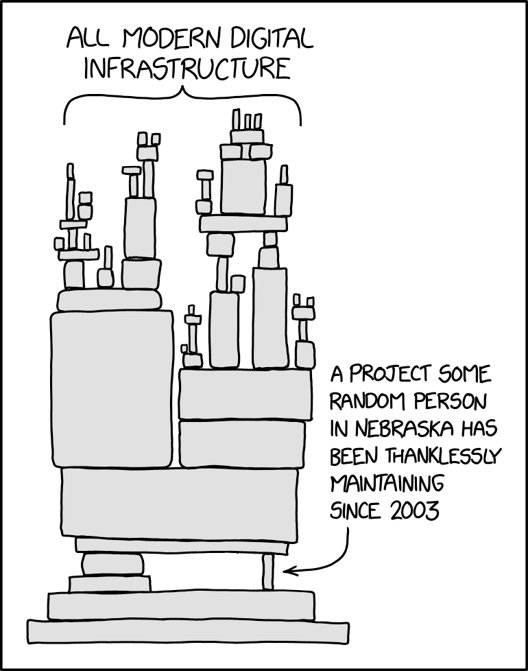
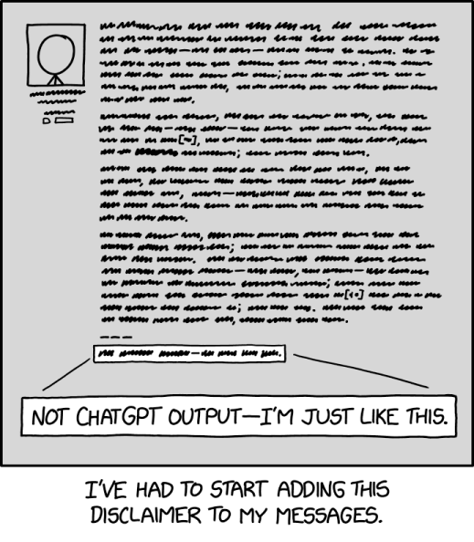

# Vendor branching : importing external artifacts without copy-pasta

<!--

--!>

<!-- comments 
FIXME: image scaling...
-->

> Someday ImageMagick will finally break for good and we'll have a long period of scrambling as we try to reassemble civilization from the rubble. [explainxkcd](https://www.explainxkcd.com/wiki/index.php/2347:_Dependency)

*(sorry for the image scale. KISS help appreciated)*

## Intro

You copied artefacts from a fancy place to your favourite VCS, tweaked it and now you discover that meanwhile the fancy place updated their code. What now?
Artefacts can be source code, data files, PDF files, supporting documentation...

This document is the zillionth attempt at explaining the vendor branching mechanism. Despite the Internet abound with how-to's, developers keep falling in the trap.

There is more: this is related to the concept of the software supply chain.

## The problem

*In short: copy-pasting artefacts is a seemingly easy way to get things imported in a project. The problem is the maintainance effort that will follow. Do not assume the data is "written in stone" and will never change any more (be it inside your project or externally). Instead, every time you import anything from outside your project, be it code or data, ***do not bluntly copy-paste***; don't just create a "fork" of foreign artefacts unless there really is no other way.*

Sometimes this problem is then solved by manual labor: porting the external changes in Stellarium, a laborous approach prone to bugs. **Extremely instructive use cases are presented on [Wikipedia](https://en.wikipedia.org/wiki/Software_rot#Forked_online_forum_example)**.

Usually references of some form are added to the source code, e.g. ftp, snail mail, http, ... The problem is that these references might **disappear** at some point in the future. **This happens all the time with personal pages.** An example can be found in [this comment](https://github.com/Stellarium/stellarium/blob/dd006bc4095790dba6ceb7fe485284a6804a9fd4/plugins/Satellites/src/Satellites.cpp#L1929-L1931): **you will get a 404**: the pages are *gone*. *Those pages should somehow have been imported as vendor data.*

The approach looks daunting, but that is only appearance.

The external (source) version of such artifacts will often continue to evolve, but these modifications obviously will not be magically reflected in the project repository, thus *sometimes, if not often* leading to artifacts slowly getting totally outdated (hence the term "[code rot](https://en.wikipedia.org/wiki/Software_rot)").

## Examples

Note that these examples are likely "lost causes"...

First, there are cases of "special interest" that are discussed separately:

1. copy-paste issues in [Stellarium](cases/Stellarium/README.md) started the whole "vendor branching" project after a discussion 
1. the [SGP4 clones](cases/SGP4/README.md) is a specific example inside Stellarium. I never thought it would become such an expanding oil spill.
1. [rejig](https://tangentsoft.com/rejig/dir?ci=tip) is imported and then patched into [a subdirectory of the C47 project](https://gitlab.com/rpncalculators/c43/-/tree/master/tools/rejig?ref_type=heads)

Furthermore, the Internet sure is full of examples. Here I list *just a very few* that I came across

- https://github.com/tudat-team/tudat-resources/issues/11
- the "npm left-pad incident" demonstrates what can go wrong when one doesn't vendor: 
	- https://en.wikipedia.org/wiki/Npm_left-pad_incident
	- https://www.theregister.com/2016/03/23/npm_left_pad_chaos/
	- https://qz.com/646467/how-one-programmer-broke-the-internet-by-deleting-a-tiny-piece-of-code
	- https://arstechnica.com/information-technology/2016/03/rage-quit-coder-unpublished-17-lines-of-javascript-and-broke-the-internet/
- or what happens when one trusts external vendors:
	- https://www.bleepingcomputer.com/news/security/dev-corrupts-npm-libs-colors-and-faker-breaking-thousands-of-apps

## A solution: package managers

https://en.wikipedia.org/wiki/Package_manager

Sometimes this can be solved by using package managers that automate the importing and updating of external "stuff" (typically code) and - important - allow to fine tune which version is to be imported.

Python's `pip -e` is a great example of this. Modifying the vendor code [is less great](https://stackoverflow.com/questions/37668773/edit-package-installed-by-pip).

An advanced example is [Activestate](https://www.activestate.com/platform/supported-languages/python).

Artefacts that can be managed by package managers are not discussed here. An inconvenience of package managers might be that local modifications might be more difficult to manage. This is precisely what vendor branching has been designed for.

And sometimes there will be no package manager provided with the artefact. Often, the artefacts will live in zip or PDF files or HTML pages...

Package managers do not allow to modify the imported code out of the box *and* benefit from external updates. Also, package managers are not always the easiest way to deal with vendors, sometimes due to a lack of experience of contributing developers that often are volunteers - that come and go.

## Amore KISS solution: **vendor branching**

As it is obvious that the problem is widespread, it feels unlikely that many users will change their minds... So this whole discussion is mainly oriented to those who are still fresh in the discipline... And especially towards devs that are about to commit a "copy-paste offence".

**Vendor branching is far easier to work with** than working with package managers, as all the required knowledge resides in how to work with branching (and merging).

The concept already exists:

- in the venerable [CVS](https://www.gnu.org/software/trans-coord/manual/cvs/cvs.html): the ["Cederqvist" PDF](https://www.gnu.org/software/trans-coord/manual/cvs/html_node/Tracking-sources.html) is delicious lecture.
- And [SVN](https://subversion.apache.org/blog/) (under ["Vendor Branches - Chapter 4. Branching and Merging"](https://svnbook.red-bean.com/en/1.8/svn.advanced.vendorbr.html)) is almost a reference.
- [FreeBSD](https://github.com/freebsd/freebsd-doc/blob/main/documentation/content/en/articles/committers-guide/_index.adoc#54-vendor-imports-with-git) also explains the Vendor Branch concept (BTW - it uses `git subree`).

Importing external artifacts requires a specific (and in this case a *simple* - believe me, it is not rocket science - as well as generic) approach: the **Vendor Branch** approach. The proposed Vendor Branch approach is KISS: *simple to apply to novice programmers*. By the way, the approach is valid in any VCS, such as SVN (where it seems to have emerged), Git, Mercurial, ClearCase, Fossil, TFS, CVS (where it already exists), you name it.

Importing external artefacts in vendor branches will also provide insight in what changed in those artefacts, just by inspecting the "diff" between successive vendor versions. Normally such changes should also be announced by the vendor.

This is in fact an important version control pattern.

## The essential steps

1. Track external changes in vendor branches
1. Do not modify anything in vendor branches
1. Updates in successive vendor artefact versions can be detected via diffs
1. ... and merged to local branches (and finally end up in your project's `main` branch)
1. Vendor tags track vendor releases
1. A local file tracks metadata about the vendor artefacts so that the vendor artefacts can always be found (until they vanish).
1. SBOM: this file should also contain checksum and GPG key fingerprint of the vendor, plus how to check it
1. Local adaptations are likely and are applied in local branches (i.e. after merging the vendor branch).
1. Later vendor releases are imported in the vendor branch and then merged. If local changes were done, those might then generate conflicts that need to be resolved. (`git rerere` could be very helpoful, BTW).
1. Feel for contributing to the vendor code? Branch off the vendor branch, send the patch and merge locally.
1. All this needs basic VCS mastery.

See ["HOW-TO"](HOW-TO.md) for the more detailed steps.

## As a side note: the reverse situation: you are the vendor

Interestingly, one could also use the same concept when "subcontracting" your code as vendor code to an outside contractor company. 

1. You create a vendor branch from (a subset of) your own code and send that to the external party. That branch might sometimes need some tweaks so that you prevent things from reaching the external party. That branch serves as a reference.
1. When changes come back you merge those changes in that vendor branch (without changing them); maybe revert some things your removed  earlier in the branch; 
1. and finally merge to your own `main`.

## The difference

1. Advantages
	- easier for the average developer
	- no manual patching, no need for separate patch scripts
	- no dependency on the vendor (or even a network connection)
1. Inconveniences
	- the repo will grow a bit larger
	- the vendor creation might much more space than needed if the vendor is huge
		- for example, one simple test shows that (using Git and Fossil as a case)
			1. a bare Fossil repo (=SQLite format) file (e.g. [rejig](https://tangentsoft.com/rpn/dir?ci=trunk)) is about ~6Mb (2026-11)
			1. `fossil open` inflates to 17M
			1. a `.git/` vendor drop of that repo takes 5.1M (8.3M but then cleaned by `git gc`)
			1. git can further reduce disk space with a sparse checkout
1. What barely changes
	- a vendor drop ingests diffs on a branch first prior to the merge
---

## See also

### vendor branching concept

- https://stackoverflow.com/questions/tagged/vendor-branch?sort=votes
- https://stackoverflow.com/questions/769786/vendor-branches-in-git
- https://en.wikipedia.org/wiki/Branching_%28version_control%29#Motivations_for_branching
- https://blog.bigsmoke.us/2009/07/20/svn-vendor-branches
- https://portal.perforce.com/s/article/3374
- https://stackoverflow.com/questions/1710027/arguments-for-and-against-including-3rd-party-libraries-in-version-control/1710050

### Github

- new topic: https://github.com/topics/vendor-branching
- other topics that might or might not be related to Vendor Branching and might benefit from switching to the `vendor-branching` topic:
	- https://github.com/topics/vendor
	- https://github.com/topics/vendor-fork
	- https://github.com/topics/vendor-management
	- https://github.com/topics/vendoring
	- https://github.com/topics/vendors
- https://github.com/stars/axd1967/lists/vendor-branching

### Copy-pasta

- https://en.wikipedia.org/wiki/Software_rot
- https://en.wikipedia.org/wiki/Copypasta#Technology
- "*[copy-paste is evil](https://stackoverflow.com/questions/2490884/why-is-copy-and-paste-of-code-dangerous)*"
- https://www.cisa.gov/resources-tools/resources/product-security-bad-practices: _"Cache copies of all open-source dependencies within the manufacturer’s own build systems and do not update products or customer systems directly from unverified public sources."_ (Dead link, see instead https://github.com/cisagov/bad-practices/discussions/101)

## TODO

Looks like this is very relevant: SBOM: 
	- https://en.wikipedia.org/wiki/Software_supply_chain
	- https://en.wikipedia.org/wiki/Supply_chain_attack
- https://en.wikipedia.org/wiki/Dependency_hell

> You say no human would reply to a forum thread about Tom Bombadil by writing and editing hundreds of words of text, complete with formatting, fancy punctuation, and two separate uses of the word 'delve'. Unfortunately for both of us, you are wrong. [explainxkcd](https://www.explainxkcd.com/wiki/index.php/3126:_Disclaimer)

