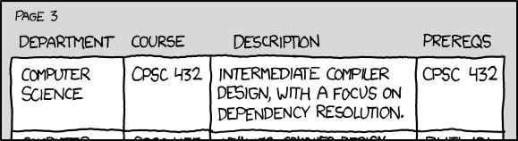
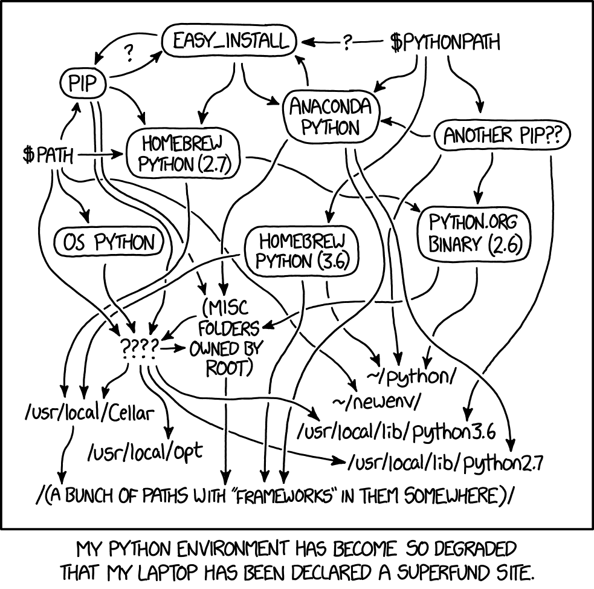
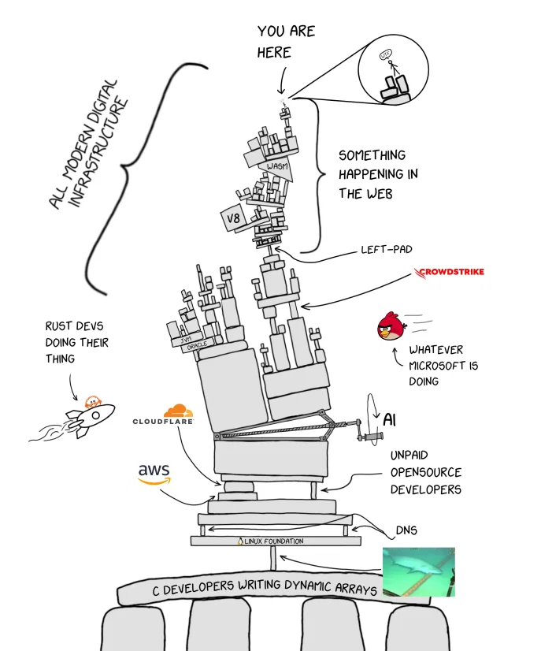
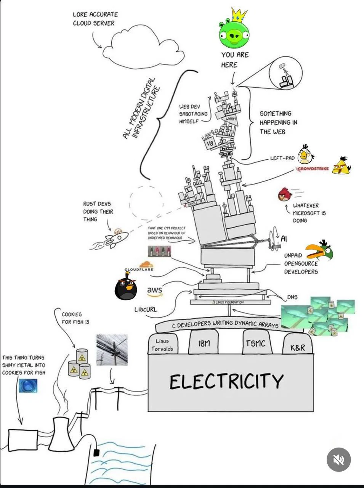

> The prereqs for CPSC 357, the class on package management, are CPSC 432, CPSC 357, and glibc2.5 or later. [explainxkcd](https://www.explainxkcd.com/wiki/index.php/754:_Dependencies)

> [explainxkcd](https://www.explainxkcd.com/wiki/index.php/1987:_Python_Environment)

<!-- TODO https://xkcd.com/2510/ -->

## Not xkcd

> from [LateNightOwl](https://social.linux.pizza/@latenightowl/115583403324505126)

See also https://mastodon.gamedev.place/@San_tiDev/115626670398590314

